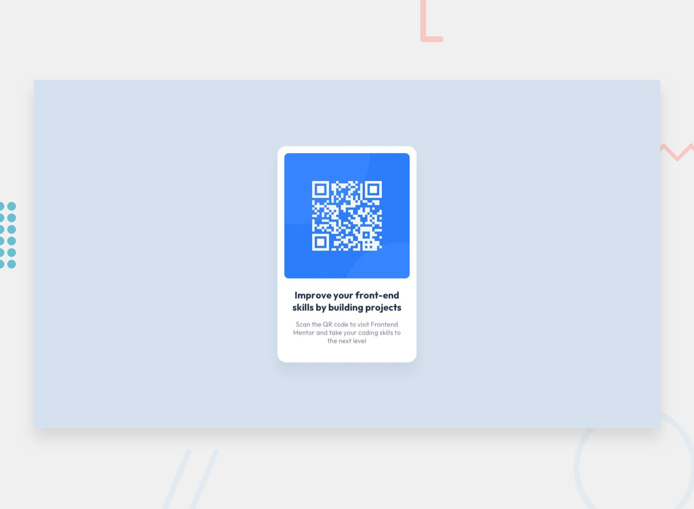

# Frontend Mentor - QR code component solution

This is a solution to the [QR code component challenge on Frontend Mentor](https://www.frontendmentor.io/challenges/qr-code-component-iux_sIO_H). Frontend Mentor challenges help you improve your coding skills by building realistic projects. 

## Table of contents

- [Overview](#overview)
  - [Screenshot](#screenshot)
  - [Links](#links)
- [My process](#my-process)
  - [Built with](#built-with)
  - [What I learned](#what-i-learned)
  - [Continued development](#continued-development)
  - [Useful resources](#useful-resources)
- [Author](#author)
- [Acknowledgments](#acknowledgments)

## Overview

### Screenshot



### Links


- Live Site URL: (https://ghazlsinjab80.github.io/qr-code-component/)

## My process

### Built with

- Semantic HTML5 markup
- CSS custom properties
- Flexbox
- Mobile-first workflow
- Google Fonts (Outfit)

### What I learned

This challenge helped me practice layout with Flexbox and understand how `position: absolute` removes elements from the normal document flow. Initially my image and heading overlapped because the image was absolutely positioned. I fixed it by removing `position: absolute` and letting Flexbox stack the elements naturally.

Example of the fix:

```css
img {
  width: 250px;
  height: 250px;
  border-radius: 1em;
  margin: 25px auto 0;
  display: block;
}